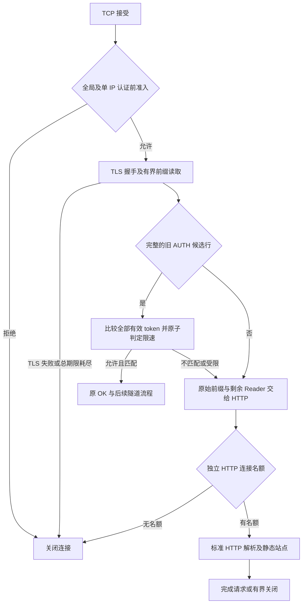

# HTTPS 入口与认证前失败处理设计

状态：已按本方案实现可选 HTTPS 回退入口，尚未部署。实现基线为 `feat/alpha-utls-connection-code` 的 `ee976148582bdedfe7bd14258c4e331088bbd0f5`；2026-10-22 设计，2026-10-23 完成实现验证。实际配置见 README，结果见[实现验证报告](https-entry-validation-2026-10-23.md)。

## 1. 本轮决策与边界

先实现同一个 TLS 端口上的双入口：正确认证的现有客户端继续使用原隧道，其他应用输入进入标准 HTTP 服务。采用 Go `net/http` 和本地静态页面，不引入外部回退网站或反向代理。认证失败不再先发送 `ERR\n`；失败原因只在本机统计。

成功连接不增加协议往返，保留 AUTH/CONNECT 流水发送、PREPARE/ACK、UDP、预读数据、半关闭和优雅退出。客户端 SOCKS 认证、监听端口、证书信任规则不随入口改动。

这是兼容现有协议的 HTTPS 回退入口。认证成功后的旧隧道仍不是 HTTP，TLS 指纹、证书和流量形态仍可观察；不能把它描述成完整 HTTPS 承载或不可探测。完整 HTTP 承载需要后续双端协议迁移。

本轮隔离审查已观察到：GET、HEAD 和随机完整行都收到固定的非 HTTP `ERR\n`；未完成输入约 5 秒后关闭；同一源的静默连接可以占满全局 setup 名额。本方案分别处理应用响应与资源公平性，不据此推断此前网络丢包的原因。

## 2. 连接流程



入口明确执行 TLS 握手，再处理应用协议。TLS、分类和首个认证/HTTP 请求头共享一个从获得 setup 名额时起算的 5 秒绝对期限；不因收到片段、转交 HTTP 或认证失败重新开始计时。

认证成功后才进入现有目标拨号、备用连接和转发流程。HTTP 分支永久失去在本连接上切回隧道的资格，即使后续请求包含正确 AUTH，也不能授权。

### 2.1 有界分类与字节所有权

分类器只为旧协议保留最多 4096 字节的原始前缀，包含换行；不能先用 `tunnel.ReadLine` 解析所有 HTTP 输入。后者会裁剪空格、拒绝 HTTP 可接受的字符，且上限并非 HTTP 请求头上限。

- 完整且满足原行协议校验的 `AUTH <token>` 才作为认证候选。保留现有大小写、空格裁剪、CRLF 和长度语义，包括原先可接受的前导空格；不额外收紧已配置 token 的内部空格。
- 对明确非 AUTH 的前缀可以提前交给 HTTP；没有在 4096 字节内形成合法 AUTH 行的输入也交给 HTTP。HTTP 自己决定它是合法请求、超长请求还是畸形输入，不把合法的较长 HTTP 请求行误判成超长隧道行。
- 分类和认证期间保存原始字节，不用规范化后的字符串重建输入。回退 Reader 按“已取走的原始字节、原 bufio.Reader 中尚未消费的数据、底层 TLS 数据”的顺序读取，不能重复或遗漏。
- 成功认证路径直接沿用原 TLS 连接与同一个 Reader；不套 HTTP 字节流包装器。HTTP 路径的包装器只负责回放和连接生命周期。
- 入口前缀识别保留 `AUTH` 作为旧协议关键字。因此 `AUTH / HTTP/1.1` 也会先被当作认证候选；若失败，再按原始输入进入 HTTP。它可能计一次凭据失败，这是兼容模式的保留关键字边界。GET、HEAD、POST 等普通方法不进入凭据比较。

### 2.2 认证判定与 HTTP 回退

从现有 `checkAuthTokenProvider` 提取“不写响应”的认证判定；仅在最终授权后写原 `OK\n`。常量时间摘要比较、最多一个有效旧 token、完整读取后重新取有效凭据及 `Authenticate(peer, matched)` 原子判定全部保留，不使用读前 `Allow` 快照代替。

错误 token、过期 token、封禁中的正确 token、限速表满均不调用 `rejectAuth`，不发送 AUTH 专用错误码、不返回 401/403、不设置 `WWW-Authenticate`，也不加人工睡眠。它们把同一输入交给同一个 HTTP 解析器，不按内部拒绝原因选择页面、状态码或写期限。

普通 `AUTH wrong\n` 缺少合法 HTTP 请求行结构，预期得到标准 400 并关闭。若候选行恰好构成合法 HTTP 请求，则按普通网站方法和路径规则处理；不能承诺所有错误 AUTH 字节串都返回 400。对同一输入，在相同资源状态下，外部行为不应暴露它是 token 错误、过期还是封禁。

认证成功后发送过 `OK` 的连接不能再回退 HTTP；CONNECT/UDP 的既有 `ERR <CODE>` 与 PREPARE 的 BUSY 保持不变。它们位于认证边界之后。

## 3. 公开 HTTPS 行为

同一个 `http.Server` 处理所有回退连接，不为每次失败启动一套服务器。使用显式私有 Handler，不挂载默认 ServeMux、pprof、expvar、配置页、版本页或运维接口。HTTP 消息格式及异常解析交给标准库，[依据 HTTP/1.1 消息规范](https://www.rfc-editor.org/rfc/rfc9112.html#section-2.2)。

| 输入或状态 | 对外行为 | 密码失败计数 |
| --- | --- | --- |
| GET `/` | 正常 200、固定公开 HTML、正确类型与长度 | 不增加 |
| HEAD `/` | 同 GET 的状态和元数据，无响应体 | 不增加 |
| GET/HEAD 未配置路径 | 标准 404，HEAD 无响应体 | 不增加 |
| 其他合法方法 | 405，`Allow: GET, HEAD`；不转发请求 | 不增加，AUTH 保留关键字例外 |
| 错误/受限 AUTH | 原始输入交给同一个 HTTP 解析器，通常 400 后关闭 | 仅完整且格式合法的 AUTH 凭据不匹配计数；封禁判定沿用现有限速器 |
| 非 AUTH 的随机行、畸形 HTTP、歧义请求长度 | 标准解析器拒绝，通常 400 后关闭，不回显输入 | 不增加 |
| 超长 HTTP 请求头 | 标准解析器的 431 后关闭 | 不增加 |
| TLS 后沉默、半条请求、读取超时/截断 | 在剩余期限内关闭，不补造 200 或认证错误 | 不增加 |
| TLS 握手失败、无共同 ALPN | TLS 层报错/关闭，不在 TLS 外发送隧道内容 | 不增加 |
| 认证前准入或 HTTP 容量耗尽 | 关闭连接，不为发送错误页额外握手/占队列 | 不增加 |

允许无 ALPN 客户端按 HTTP/1.1 进入；服务端仍只声明实际支持的 `http/1.1`。只提供 h2 的客户端按无共同协议处理，不为外观增加未实现的 h2。

公开页面为内嵌普通静态页，或启动时载入一份明确指定的 HTML 文件。文件最多 64 KiB，必须是普通文件，不接受符号链接；读取失败拒绝启动。只服务该内存副本，不暴露目录、动态文件读取、模板执行、外部资源下载或后端代理。首页内容可以替换为自己持有的网站内容，不复制第三方品牌，不包含 MyGoTunnel、节点配置和版本标识。

不根据 Host、绝对 URI、CONNECT 参数、URL、查询串、SNI 或任何请求头决定回退拨号地址。包括 `CONNECT host:port` 在内的未授权 HTTP 请求均不得产生目标连接。无第三方固定回退后端，故没有后端断连、凭据透传或 SSRF 回退路径。

第一版支持有界 HTTP/1.1 keep-alive：空闲最多 15 秒、每连接最多 8 次请求，第 8 次响应声明关闭。请求带非空或未知长度 body 时不读取业务 body，关闭复用并返回对应公开响应；不触发 `100 Continue`，不进行无界 drain。复用连接上的每次请求头仍有独立 5 秒期限，但首请求必须受入口原始绝对期限约束。以上需要实测标准库关闭时的隐式 body drain，不能仅设置响应头后假定不会读取。

## 4. 时限、资源与退出

### 4.1 时限

| 阶段 | 设计值与约束 |
| --- | --- |
| TLS + 分类 + 首个 AUTH/HTTP 请求头 | 共享原有 5 秒绝对期限，分片不能续命 |
| 失败认证转 HTTP | 沿用剩余入口读取时间；已到期则直接关闭 |
| HTTP 响应写入 | 最多 5 秒；已经没有读取机会的错误连接不再新开写预算 |
| HTTP 请求头 | `MaxHeaderBytes=16 KiB`；预算要包含标准库额外读取余量，不能声称严格只读 16 KiB |
| HTTP keep-alive | 15 秒闲置、最多 8 请求；不占认证前 setup 名额 |
| 已认证控制/目标/转发 | 继续原控制预算、ACK 期限、目标结果独立 1 秒写期限及 UDP 阻塞保护 |

使用[标准库 Server 的超时和连接状态机制](https://pkg.go.dev/net/http#Server)，但不能让其 `SetReadDeadline`/`SetDeadline` 清除或延长入口绝对期限。HTTP 连接适配层在首个请求头完成前夹紧期限；只有 Handler 确认首请求解析成功后才能解除。解析失败/超时直到关闭都不解除。其后使用正常 HTTP 读写/空闲期限。

HTTP 包装连接的 TLS 状态通过 ConnContext 保存，避免旧 Go 版本对 `*tls.Conn` 的类型识别差异导致策略失效；不依赖包装器自动启用 HTTP/2。现有 Go 1.24 模块兼容要求要单独验证，不能只以本机工具链行为为依据。

### 4.2 独立资源保护

原 `-max-connections`（默认 1024）继续覆盖全部已接受连接；`-max-setup`（默认 128）覆盖 TLS、认证、首个 HTTP 请求头及原隧道 setup。新增约束在 TLS 握手前生效：

- 每 IP 的认证前并发：默认 `min(32, max(1, ceil(max-setup/4)))`，默认全局值对应 32；允许显式调高以适配共享 NAT。
- 每 IP 的新接受连接速率：默认每秒 20 个、突发 40 个。它独立于密码错误限速，适用于 AUTH 和网页访问，不以解析结果退款。
- HTTP 连接独立上限：默认 64，且仍受全局连接上限约束。名额在交给 HTTP 服务器前非阻塞申请，失败立即关闭，不能新增无界排队。
- 单 IP 计数/速率状态表最多 4096 项，有界清理；表满时拒绝未知 peer，不驱逐仍有活跃计数的项。并发准入、释放和速率扣减需要原子一致；退出清理不得造成负计数或绕过上限。

只使用 TCP 对端的规范化 IP 作为来源，不信任客户端提供的 X-Forwarded-For 等头。若将来加入受信前置代理，须另设计可信来源及地址传递，不能直接沿用头字段。

密码错误继续使用现有独立窗口：同 IP 一分钟内 5 次失败封禁一分钟，上限 4096 项。网页访问、TLS 错误、半包、超时不计密码失败，也不能清除封禁。共享 NAT 下的恶意持证格式请求仍可能影响同出口用户，此方案不能按 IP 区分同出口的不同人。

上述新增额度是初始设计值，必须通过已有池最大 32、池补充加前台并发、共享 NAT 突发的测试校准；不是已验证的生产阈值。IPv6 多地址/多 IP 仍可能耗尽全局资源，单 IP 限制不是分布式攻击防护。

### 4.3 所有权与退出

| 分支/交接 | setup 名额 | 认证前单 IP 并发 | HTTP 名额 | 全局连接名额 |
| --- | --- | --- | --- | --- |
| TLS/分类/AUTH/首个 HTTP 头 | 保留 | 保留至成功 AUTH 或首 HTTP 头完成 | 仅 HTTP 分支申请 | 保留 |
| AUTH 成功进入原目标 setup | 按原逻辑保留 | 释放 | 无 | 保留 |
| 已认证 PREPARE 等待/转发 | 按原逻辑释放、取用时重取 | 已释放 | 无 | 保留 |
| HTTP Handler/keep-alive | 释放 | 已释放 | 保留至连接关闭 | 保留 |
| 任意失败/超时/关闭 | 全部幂等释放 | 全部幂等释放 | 若已申请则释放 | 连接结束时释放 |

HTTP 分支交接后，admission handler 需要等待实际连接关闭才能返回，不能因投递给 HTTP listener 就提早减少全局计数。新建的进程级 HTTP listener 通道容量有界，交接受取消控制；关闭状态必须可唤醒投递者与等待者，不以逐连接 goroutine 创建独立 http.Server。

停止接受后关闭交接 listener，停止新的 setup；已有 HTTP 请求在有界 grace 内完成并关闭空闲连接。已认证 TCP/UDP 继续原有 drain 语义，grace 耗尽由 `Permit.AbortContext()` 强制关闭。HTTP Server.Shutdown 与连接 handler 等待必须有明确次序，不能双方互等；强制退出关闭实际底层连接并等待任务退出。原 HTTP Reader 只能有一个所有者。

## 5. 配置、证书与旧客户端

以下字段已在本轮源码中实现；部署时需核对二进制版本与启动日志，旧二进制会忽略这些字段：

```json
{
  "https_entry": {
    "enabled": true,
    "index_file": "/etc/mygotunnel/public/index.html",
    "max_connections": 64,
    "max_pre_auth_per_ip": 0,
    "pre_auth_rate_per_ip": 20,
    "pre_auth_burst_per_ip": 40
  }
}
```

`https_entry` 缺省或 enabled=false 保留当前入口行为；新保护在启用该入口时生效。enabled=true 时 index_file 缺省使用内嵌页；其余数字 0 取上文默认/自动值，负数、溢出、无效路径拒绝启动。显式并发值不能超过相应全局上限；入口数字字段上限为 10000，校验与文档同步。

启动日志必须明确 `https_entry=true/false` 及实际生效额度、HTTP/ALPN 支持，但不输出文件内容、凭据或连接码。配置诊断覆盖这部分；回滚到忽略未知字段的旧二进制会恢复旧 ERR 行为，运维须核对运行版本与启动字段。

第一阶段不新增客户端 transport 字段、不更改连接码版本、不换线上证书。当前客户端普通连接和预连接的第一响应只接受 `OK`，因此 HTTP 拒绝仍是认证失败；必须回归确认不会进入 ACK 兼容降级、错误重试或写入业务负载。成功 AUTH wire 保持原样，旧客户端应继续工作。

证书和站点身份是独立迁移：现有自签名 IP 证书可以提供 HTTP，但普通浏览器仍会报不受信任，不能称为无需警告的公开 HTTPS 网站。要达到后者，使用自己控制的域名与对应受信证书链；本设计不预设未提供的域名，不借用无所有权域名的 SNI。

保留现有未知/无 SNI 的默认入口和 IP 客户端兼容，不引入仅凭 SNI 允许隧道的规则。将来更换证书时需同步迁移客户端叶证书 pin，并留回滚材料；不临时关闭 pin/CA/主机名验证。本阶段 ALPN 与证书策略不自动随网页文件改变。

## 6. 代码落点与统计

| 位置 | 实现职责 |
| --- | --- |
| `cmd/server/main.go` | 组织共享 HTTPS 入口；分离认证判定、响应和认证后处理；保留单一 Reader 交接 |
| 新 `internal/ingress` | 有界分类、原始前缀回放、HTTP 服务器与交接生命周期、首请求绝对期限 |
| `internal/admission` | 支持接受后、握手前的单 IP 准入；复用原总连接、setup、grace 计数；不增加无界队列 |
| `internal/authlimit` | 复用既有原子认证判定；新连接速率机制不挤占密码失败表 |
| `internal/config/server.go` | 增加入口结构、默认值、有效性和配置诊断测试 |
| `internal/logging`、观察器与文档 | 单列入口指标，不把普通网站流量混入代理成功率和耗时分位数 |
| `cmd/client`、`internal/preconnect` | 以兼容回归为主；只有测试发现拒绝处理不满足契约时才调整，不新增成功握手往返 |

实现提供累计计数 `ingress_tls_failed`、`ingress_pre_auth_timeout`、`ingress_ip_limited`、`ingress_http_capacity_rejected`、`ingress_http_requests`、`ingress_http_unparsed`、`ingress_auth_rejected`、`ingress_http_internal_errors`、`ingress_http_write_failed`；增加 HTTP 活跃连接及认证前活跃数。unparsed 表示未到达首个 Handler 的非超时 HTTP 连接，包含提前关闭，避免声称能精确统计标准库的解析错误。每次密码失败/封禁仍用原认证计数，不能重复算一次代理故障。

标准库解析错误不一定到达 Handler；统计通过适配层/连接结果归类，无法可靠区分的归入 unknown，不靠解析自由文本日志凑精确计数。30 秒聚合输出，不逐探测请求打 WARN。HTTP ErrorLog 适配到安全日志接口，只输出固定原因；不能把标准库格式串/参数或请求行原样写出。公开响应不带内部 connection_id、限速原因和软件版本。

禁止记录 URL 路径、查询串、Authorization、AUTH 原始行、token/摘要、HTTP body。网页访问只按有限方法/状态类别聚合，错误值不直接取未约束输入。真实代理请求继续保留原目标诊断及 TCP/UDP 日志。

## 7. 验证与验收

实现时先跑独立回环服务与临时证书，全部使用随机测试 token，不向生产入口发送错误认证或耗尽探测。

| 测试组 | 必须证明的结果 |
| --- | --- |
| 正常网页 | TLS 1.2/1.3；h1/无 ALPN；GET、HEAD、404、405；长度、HEAD 无 body、keep-alive 与上限正确 |
| 认证失败 | 随机/过期/封禁 token 外部走相同解析流程；没有先 ERR 再 HTTP；正确 token 在封禁中不能授权；旧 token 到期边界不漏放 |
| 输入边界 | 每字节分片、无换行、4095/4096/4097 边界、原先允许的空格/CRLF、HTTP 合法空白与长请求行；非 HTTP 控制字符、CL/TE 歧义由标准解析器拒绝 |
| 回放与隔离 | 失败 AUTH 拼接 CONNECT/UDP/第二条正确 AUTH 均不拨号；未知 Host、绝对 URI、CONNECT、升级头均不产生回退拨号 |
| 旧客户端 | 普通 TCP/UDP、legacy PREPARE、新 ACK、池命中/未命中；认证拒绝不降级、不重试、不发送应用负载；正确 AUTH 字节序列和往返数不变 |
| 预读与半关闭 | AUTH+CONNECT+应用数据一次写入无丢失/重复；上传 FIN 后反向排空；UDP 控制断开取消；期限清除不误杀长连接 |
| 时限与资源 | TLS/半包/失败回退不重置 5 秒；HTTP 隐式 drain/慢读/慢写均有界；4 全局 setup 下单 IP 默认只占 1，另一源可握手；表满 fail-closed、配额原子释放 |
| 生命周期 | HTTP 空闲不占 setup；HTTP 饱和不新增队列；投递时退出、TLS/HTTP 处理中退出、grace 内排空及超时强制退出均无计数/任务泄漏 |
| 日志与配置 | 无路径或凭据；默认/启用/禁用/非法值/文件失败；观察器不把 HTTP 请求计入代理失败率；Go 1.24 与生产工具链兼容 |

性能对照固定相同代码基线、TLS 证书、目标和负载，仅切换入口功能。先做本机 A/B/B/A，分别覆盖池命中、池未命中、TCP 大流、UDP 多目标和正常网页加有界未认证慢连接混合流量。报告成功建连 P50/P95/P99、失败分母、吞吐、CPU、alloc/op、RSS、连接/任务数；负载结束后确认计数和任务回落。

成功隧道的额外应用层往返必须为 0。以至少 1000 次成功 setup 的可重复样本检查本机 P95 是否持续增加超过 `max(1ms, 基线5%)`，大流中位吞吐是否持续下降超过 5%；超过时阻止部署并分析。该阈值是回归门槛，不是线上时延承诺；报告同时保留失败样本，不能只报成功 P99。

完成代码后运行 `go test ./...`、`go test -race ./...`、`go vet ./...`、`go build ./cmd/...`，并执行相关 Python 观察器回归。再在两端独立测试端口验证，保留原 SOCKS 认证与运行实例。生产切换单独发布，通过明确 commit/version、健康检查与原运维回滚流程完成。

## 8. 后续完整 HTTPS 承载的选择

| 方案 | 适用范围 | 主要代价 |
| --- | --- | --- |
| 本次同端口 HTTP 回退 | 旧客户端兼容，消除普通请求得到固定非 HTTP ERR 的暴露 | 已授权隧道仍是自定义流，保留 AUTH 关键字边界 |
| 标准 WSS 承载 | 双端都先完成真实 HTTP Upgrade，再使用合法 WebSocket 帧 | 新连接可能多一次 Upgrade 等待；有 framing/masking 成本，且需设计流式适配与半关闭语义 |
| HTTP/2 承载 | 需要真实 h2 的部署或多路复用需求 | 双端流控、共享 TCP 队头阻塞及迁移复杂，不能仅增 ALPN |

暂不叠加填充、随机延迟或额外加密。若后续选择 WSS，遵循[标准握手和消息帧](https://www.rfc-editor.org/rfc/rfc6455.html#section-4)，不能在 101 后裸写旧协议冒充 WebSocket；显式选择传输，不因认证错误自动退回旧模式。先量化池未命中延迟和半关闭代价，再决定是否迁移，不把本轮回退入口当成完整迁移已经完成。

## 本次交付验证

第一轮交付设计；本轮按设计实现入口、准入保护、配置与诊断，并补充测试。线上配置、证书和运行服务尚未改动。第 7 节为完整验收矩阵，实际已执行项目另记验证报告，不能把计划项当成已验证的公网性能或长期稳定性。

现有认证封禁、无效/截断输入、ACK 拒绝不降级、预读交接及旧 PREPARE 的五项定向回归通过：

```sh
go test ./cmd/server ./internal/preconnect -run 'TestTokenAuthenticationChecksBlockAfterCredentialComparison|TestInvalidAndTruncatedTokenRequestsDoNotCountCredentialFailures|TestPrepareACKRefusalAndMalformedResponseDoNotRetry|TestPrepareACKNegotiationPreservesBufferedDataAndConnection|TestPrepareLegacyAPIKeepsOriginalProtocol' -count=1
```

以上是设计阶段的原有行为基线回归；新增入口的真实 TLS/TCP/UDP、资源与错误边界验证见本轮实现验证报告。
